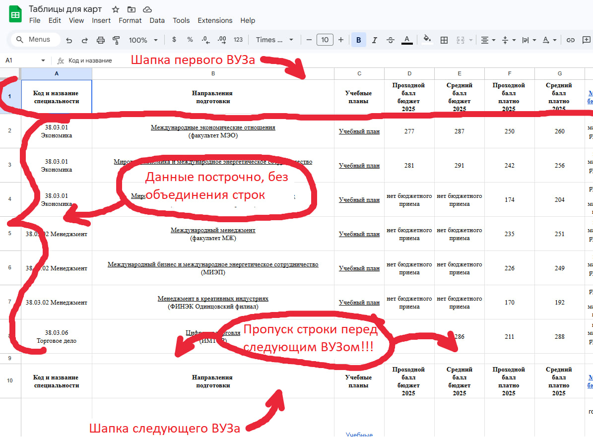
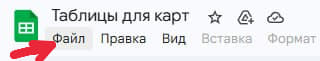
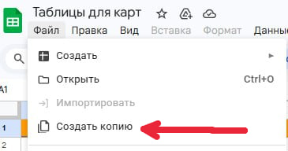
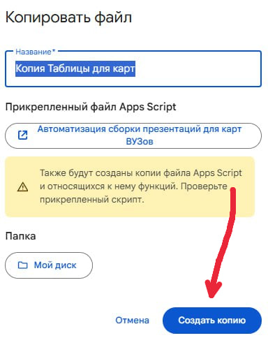
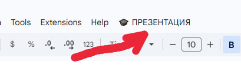
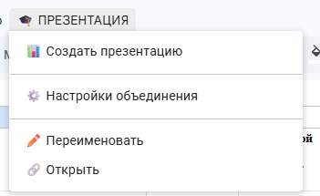
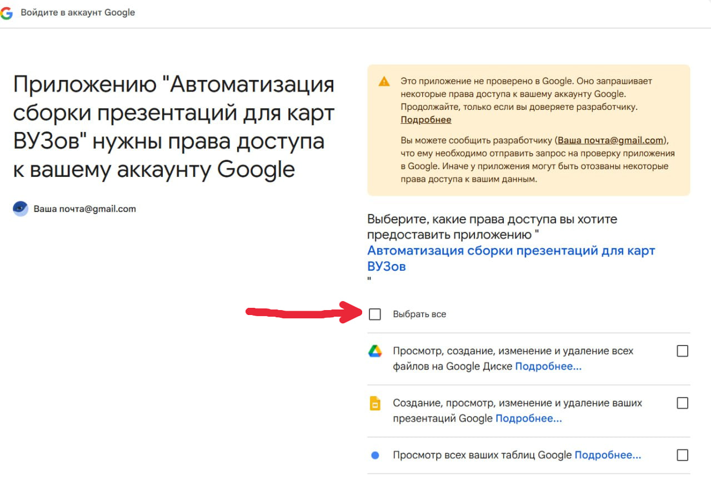
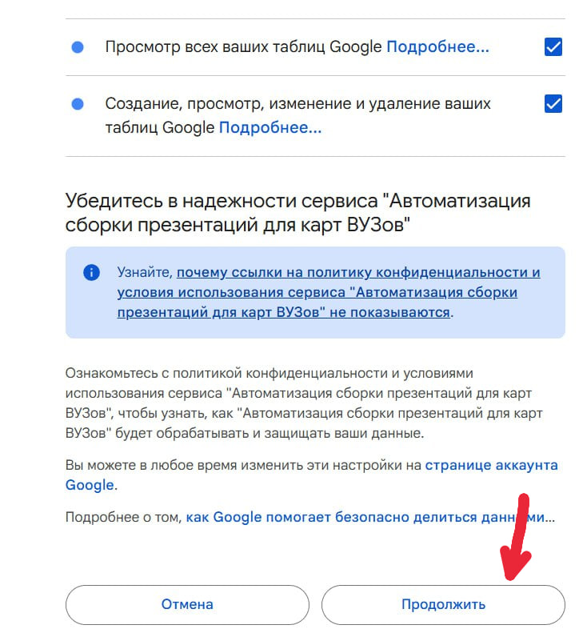

# Google-presentations-automation
Скрипт автоматизации форматирования шаблонных табличных данных в презентации в корпоративном стиле
# Документация по работе с проектом «Карта вузов»

## Что это за проект

Вам дали ссылку на Google Таблицу, внутри которой есть готовая программа (скрипт). Эта программа автоматически создает красивые презентации в Google Slides на основе ваших данных.

Что делает программа:
- Читает данные из таблицы.
- Сама создает слайды с таблицами.
- Разбивает длинные списки на несколько слайдов.
- Сохраняет все ссылки.
- Подставляет нужные названия и даты.

## Как получить доступ

1. Откройте ссылку 
2. Сделайте свою копию файла (это обязательно!):
   - Нажмите **Файл → Создать копию**.
   - Назовите файл как хотите (например, «Карта»).
   - Нажмите **ОК**.
3. Теперь файл ваш, и вы можете его менять.

## Как заполнить файл

В файле два листа:

### Лист `variables` (переменные)

Сюда записываются данные, которые нужно подставить в презентацию (фамилия, дата, названия вузов).

При желании первые 7 строк столбца B можно оставить пустыми. В таком случае после создания презентации эту информацию можно будет заполнить самостоятельно уже в файле презентации.

Если в карте более 20 вузов, можно добавить новые переменные по аналогии: в столбец A добавить тег `{{ВУЗN}}`, где `N` — номер вуза, а в столбец B — значение.

Структура листа `variables`:

| Переменная | Данные |
|---|---|
| `{{Фамилия}}` |  |
| `{{Направления}}` |  |
| `{{Вузы}}` |  |
| `{{Города}}` |  |
| `{{Форма}}` |  |
| `{{ЕГЭ}}` |  |
| `{{Правила}}` |  |
| `{{ВУЗ1}}` |  |
| `{{ВУЗ2}}` |  |
| `{{ВУЗ3}}` |  |
| `{{ВУЗ4}}` |  |
| `{{ВУЗ5}}` |  |
| `{{ВУЗ6}}` |  |
| `{{ВУЗ7}}` |  |
| `{{ВУЗ8}}` |  |
| `{{ВУЗ9}}` |  |
| `{{ВУЗ10}}` |  |
| `{{ВУЗ11}}` |  |
| `{{ВУЗ12}}` |  |
| `{{ВУЗ13}}` |  |
| `{{ВУЗ14}}` |  |
| `{{ВУЗ15}}` |  |
| `{{ВУЗ16}}` |  |
| `{{ВУЗ17}}` |  |
| `{{ВУЗ18}}` |  |
| `{{ВУЗ19}}` |  |
| `{{ВУЗ20}}` |  |

### Лист `table` (основные данные)

Здесь хранятся сами таблицы с цифрами и ссылками.

Структуру таблицы можно менять: столбцы разрешается убирать и переименовывать. **Ограничение — не более 14 столбцов.**

| Код и название специальности | Направления подготовки | Учебный план | Проходной балл бюджет 2025 | Средний балл бюджет 2025 | Проходной балл платно 2025 | Средний балл платно 2025 | Min балл ЕГЭ бюджет\платно | КЦП бюджет 2026 | КЦП платно 2026 | Учет баллов за ИД | Стоимость обучения 2025 | Общежитие |
| --- | --- | --- | --- | --- | --- | --- | --- | --- | --- | --- | --- | --- |

Как заполнять:
1. Первая строка — это шапка (она уже есть, не удаляйте её).
2. Дальше идут данные: каждая строка — одна специальность.
3. Когда заканчивается один вуз, оставьте одну пустую строку.
4. Затем добавьте следующую шапку (у каждого вуза могут быть свои ссылки в шапке).
5. После шапки снова добавьте данные.

**Важно про ссылки.** Если хотите, чтобы в презентации были кликабельные ссылки, вставляйте их через меню **Вставить → Ссылка** (или `Ctrl+K`).

**Важно про объединение строк.** Для корректной работы программы старайтесь избегать объединений в оригинальной таблице. Лучше дублируйте информацию в необходимых ячейках. Тогда программа корректно прочитает данные и сможет красиво объединить ячейки уже в презентации.

Пример заполнения листа `table` (этот же пример находится в файле):

## Как запустить программу

Нажмите **🎓 ПРЕЗЕНТАЦИЯ** в шапке файла и выберите нужную команду:
- **📊 Создать презентацию** — создает новую презентацию.
- **✏️ Переименовать** — меняет имя последней презентации.
- **⚙️ Настройки объединения** — настройка объединения по столбцам.
- **🔗 Открыть** — открывает последнюю созданную презентацию.

## Пошаговая фото-инструкция

### Шаг 1. Откройте файл по ссылке. В открывшемся окне нажмите кнопку «Файл».

### Шаг 2. Выберите «Создать копию».

### Шаг 3. В открывшемся окне копирования файла нажмите «Создать копию».

### Шаг 4. Откройте копию файла. В открывшейся таблице нажмите «🎓 ПРЕЗЕНТАЦИЯ» в верхнем меню.

### Шаг 5. Во всплывающем списке расширений выберите необходимую процедуру.

### Шаг 6. При первом запуске система попросит предоставить разрешения. Программа запрашивает доступ к Google Диску, чтобы создавать презентацию, менять её название, находить и автоматически открывать презентацию. В появившемся окне нажмите «Проверить разрешения».

### Шаг 7. Далее откроется окно с предупреждением: Google сообщает, что программа сможет менять данные на диске (создавать файлы и менять их названия). Нажмите «Дополнительные настройки».

### Шаг 8. После открытия дополнительных настроек появится кнопка «Перейти на страницу “Автоматизация сборки презентаций для карт ВУЗов”». Нажмите на эту ссылку.

### Шаг 9. Откроется окно разрешений для программы. Нажмите кнопку «Выбрать все».

### Шаг 10. Прокрутите окно ниже и нажмите «Продолжить».

### Шаг 11. После выполнения этих действий скрипт запустится. После успешного выполнения операции откроется созданная презентация.

## Что получится

**[Открыть пример готовой презентации](https://docs.google.com/presentation/d/1uTz4urgKz0q51le40ky-LwFwZ18Q8u1ZlSmgIKNZ448/edit)**

Первые два слайда презентации — опциональные. По требованиям выберите необходимый слайд по содержанию или названию:
- «Дисклеймер для карты вузов на сопровождении»;
- «Дисклеймер для разовой услуги».

---

> Примечание: скриншоты вынесены в папку `images`. При загрузке на GitHub сохраните папку рядом с `README.md`, иначе изображения не отобразятся.
